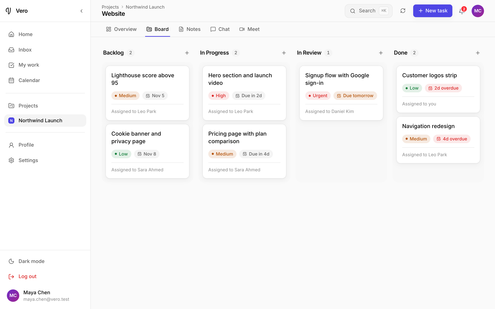
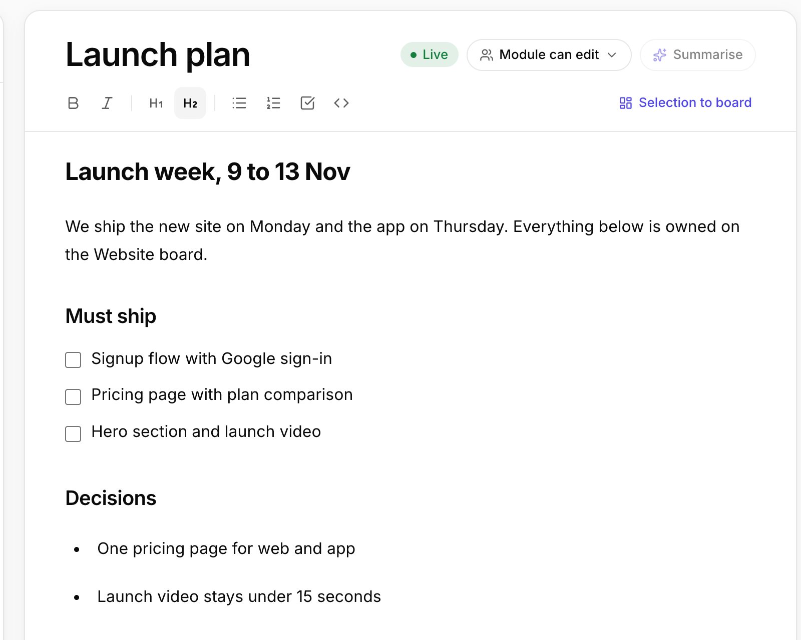
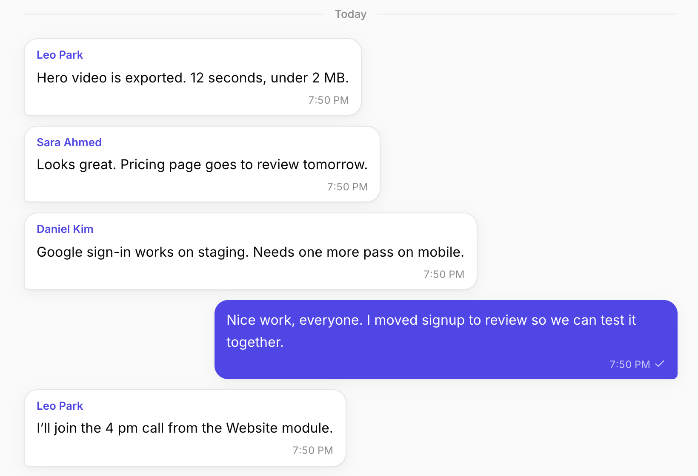
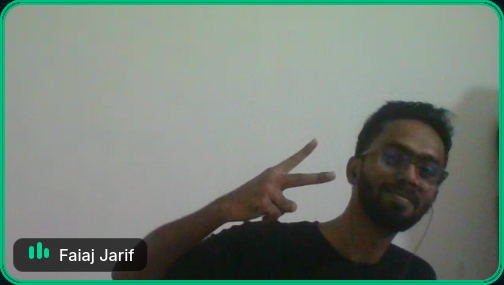
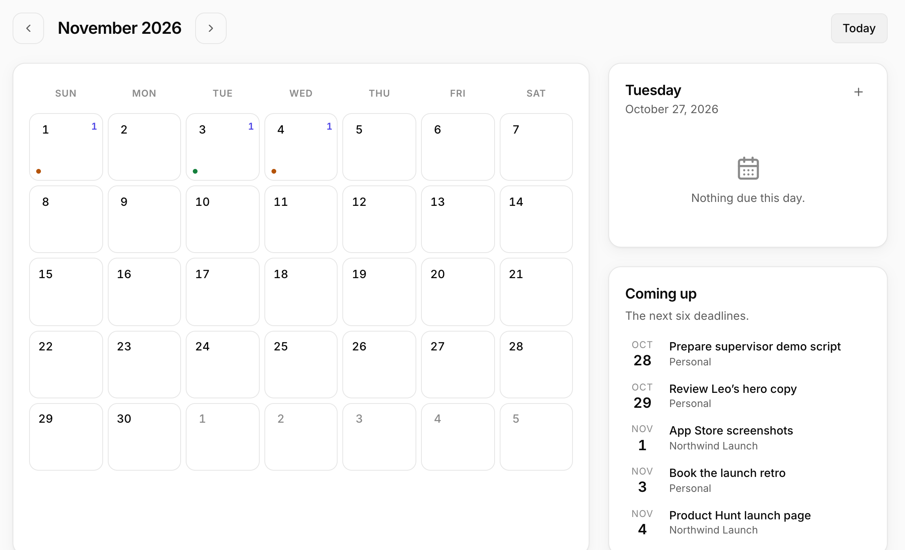
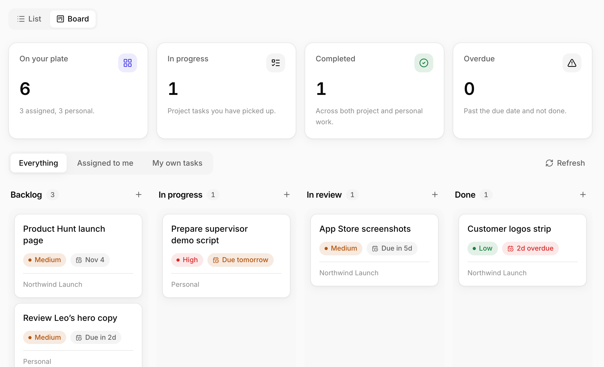
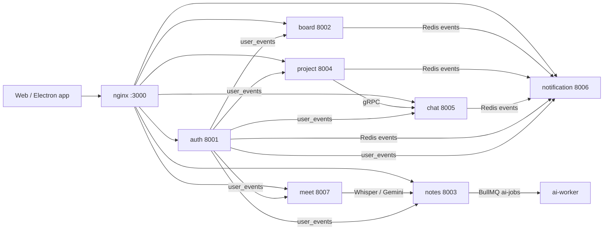
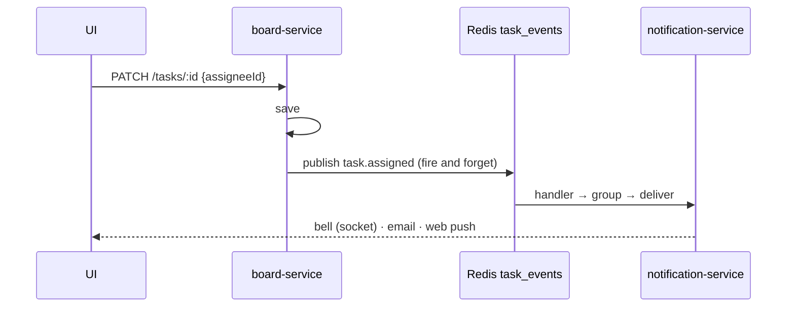
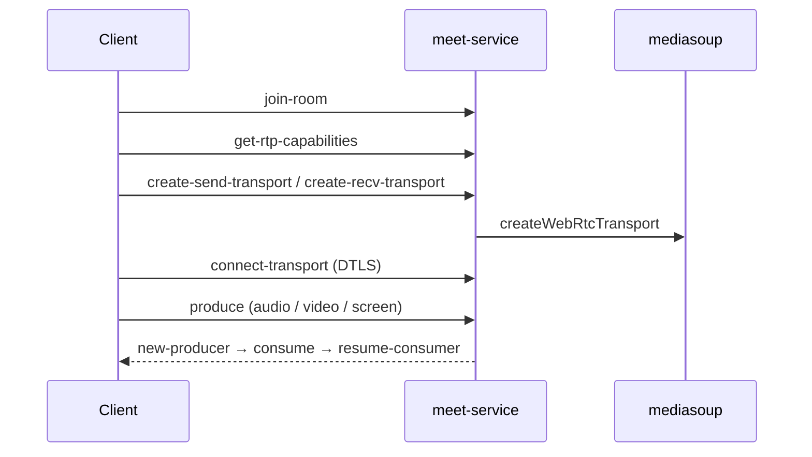

<p align="center">
  
</p>

<h3 align="center">Your team's work. One place.</h3>

<p align="center">
  Boards, notes, chat, video calls and a calendar, organised by project and module.<br>
  Built by three people for Software Project Lab 2, IUT, 2026.
</p>

<p align="center">
  
  
  
  
  
  
  
  
  
</p>

<p align="center">
  <a href="#why">Why</a> ·
  <a href="#the-idea">The idea</a> ·
  <a href="#features">Features</a> ·
  <a href="#architecture">Architecture</a> ·
  <a href="#tech-stack">Tech stack</a> ·
  <a href="#run-it">Run it</a> ·
  <a href="#repository-layout">Layout</a> ·
  <a href="#engineering-notes">Engineering notes</a> ·
  <a href="#team">Team</a>
</p>

---

## Why

A student team in 2026 runs one project across six tools: a task list, a Kanban board, a notes app, a chat app, a video app and a calendar. None of them know about each other. A decision made in a call never reaches the board. A deadline in the notes never reaches the calendar.

Vero puts all of it in one window, and makes the pieces aware of each other.

<p align="center"></p>

## The idea

Everything hangs off one concept.

```
Project
└── Module  (Frontend, Backend, DB schema, …)
    ├── Board      Kanban: Backlog → In progress → In review → Done
    ├── Notes      live collaborative documents
    ├── Chat       one room, right people already in it
    └── Meet       a call room, no links
```

When you create a module, its tools are provisioned for it. You never set anything up. Membership and roles (`admin`, `member`, `viewer`) are per project and flow down to every module.

## Features

<details open>
<summary><b>Board</b> — plan it</summary>
<br>


- Four default columns, custom columns, drag-and-drop with keyboard support (`dnd-kit`)
- Optimistic updates: the card moves instantly, rolls back with a toast if the server disagrees
- Assignee, priority, due date with overdue badges, labels, description
- Assigning a task publishes `task.assigned`; the assignee gets a bell, an email and a browser push
</details>

<details>
<summary><b>Notes</b> — write it together</summary>
<br>


- Tiptap editor on top of a Yjs CRDT: several people type at once, text converges without locks
- Live cursors and names through Yjs awareness
- Private notes save plain HTML over REST; public editable notes go through the WebSocket room
- Ask AI for a digest of any note (Gemini, through the AI worker)
- Meeting transcripts and minutes land here automatically
</details>

<details>
<summary><b>Chat</b> — talk it through</summary>
<br>


- One group channel per module, created the moment the module exists (gRPC from project-service)
- Direct messages between connected users (friend-request style connections)
- Socket.IO rooms, typing indicators, presence, read receipts, optimistic bubbles reconciled by `clientId`
- Redis adapter so two chat instances share the same rooms
</details>

<details>
<summary><b>Meet</b> — right here</summary>
<br>


- Our own media server: a Mediasoup SFU. Each person uploads once, the server forwards to everyone else
- Camera, mic, screen share; Opus / VP8 / VP9 / H264
- Live transcription: one browser mixes the call audio, sends 6-second chunks, Whisper (Groq, OpenAI fallback) writes the transcript into a note
- When the call ends, Gemini writes the meeting minutes into a second note
</details>

<details>
<summary><b>Calendar and My work</b> — your week, every project</summary>
<br>



- Every deadline you own, across every project, in one month view with the next six coming up
- My work: everything assigned to you anywhere, plus a private personal task list
</details>

<details>
<summary><b>Notifications</b> — one action, everyone knows</summary>
<br>

- A service that only listens: it subscribes to every Redis event channel
- Groups repeats (same user, type and entity within two minutes) into one notification
- Delivers to the bell (Socket.IO room per user), web push (VAPID) and email
</details>

<details>
<summary><b>Accounts</b></summary>
<br>

- Better Auth with email, Google and GitHub sign-in
- A JWT is minted per session so every service can verify a user locally
- Gmail integration for the mail widget
</details>

## Architecture

One app in front, seven services behind it, each with its own PostgreSQL database. Services never share tables. They talk in three ways:

| Channel | Used for | Example |
|---|---|---|
| **Redis pub/sub** | "something happened" | board publishes `task.assigned`, notification-service reacts |
| **gRPC** | "do this now, I need the answer" | project-service asks chat-service to create a module's channel |
| **BullMQ** | background jobs that may retry | provisioning a module, summarising a note |



<details>
<summary>What happens when a task is assigned</summary>



Board never calls notification-service. If notifications are down, the task still saves.
</details>

<details>
<summary>How a call is set up</summary>


</details>

<details>
<summary>How notes merge without a lock</summary>

Each note is a Yjs document. Every edit becomes an update tagged with the client id and a clock, and inserts reference their left and right neighbours. Concurrent updates can be applied in any order and converge to the same text. The server (`y-websocket`) relays updates between clients and writes the merged state to Postgres when the last client leaves.
</details>

## Tech stack

| Layer | Choices |
|---|---|
| Interface | React, Vite, Tailwind, Radix UI, Tiptap, Zustand, framer-motion, dnd-kit |
| Apps | Web (Vite) and desktop (Electron) from one shared UI package |
| Services | Node.js, Express, TypeScript, Zod |
| Data | PostgreSQL (one database per service), Drizzle ORM, Redis |
| Real-time | Socket.IO (+ Redis adapter), Yjs, gRPC, BullMQ |
| Video | Mediasoup SFU, coturn |
| Auth | Better Auth, JWT, Google and GitHub OAuth |
| AI and APIs | Whisper via Groq (OpenAI fallback), Gemini, Gmail API |
| Delivery | Docker Compose, nginx, GitHub Actions |
| Quality | Vitest (180 tests against real Postgres and Redis), Prometheus, Grafana |

## Run it

**Prerequisites:** Bun, Node 20+, PostgreSQL 16, Redis 7. nginx for the clustered stack; Docker for Compose.

<details open>
<summary><b>Clustered dev stack</b> (two instances of every service behind nginx)</summary>

```bash
cd code
./scripts/dev-stack.sh            # http://localhost:3000
```

| Flag / subcommand | Does |
|---|---|
| `--lan` | expose on your Wi-Fi at `http://<lan-ip>:3000` |
| `--tailnet` | expose on your Tailscale mesh with TLS |
| `--tunnel` | public URL through zrok2 |
| `--bg` | run detached |
| `stop` · `status` · `restart` | manage the cluster |
| `monitoring` | Prometheus `:9090` and Grafana `:3001` in Docker |

Primary instances listen on 8001–8007 (gRPC 5005), secondaries on 8011–8017 (gRPC 5015).
</details>

<details>
<summary><b>Docker Compose</b> (single instance of everything)</summary>

```bash
cd code/infra/docker
cp .env.example .env            # fill in keys
docker compose up --build
```
</details>

<details>
<summary><b>One service at a time</b></summary>

```bash
cd code/services/board-service
cp .env.example .env
bun install
bun run migrate
bun dev                         # tsx watch, port from .env
```

Every service and `apps/ui` has an `.env.example`. The web app runs with `cd code/apps/web && bun dev`.
</details>

<details>
<summary><b>Tests</b></summary>

```bash
cd code && ./scripts/test-all.sh
```

CI (`.github/workflows/ci.yml`) typechecks every package, runs the same script against Postgres and Redis service containers, and builds web and desktop on every push and pull request.
</details>

## Repository layout

```
code/
├── apps/
│   ├── ui/          shared React app: pages, components, features, stores, hooks, ws
│   ├── web/         Vite shell
│   └── desktop/     Electron shell
├── services/
│   ├── auth-service          Better Auth, JWT, OAuth, Gmail
│   ├── board-service         boards, columns, tasks, My work
│   ├── notes-service         documents, Yjs WebSocket, AI digest
│   ├── project-service       projects, modules, members, provisioning
│   ├── chat-service          channels, messages, presence, gRPC server
│   ├── notification-service  event subscriber, grouping, bell / push / email
│   └── meet-service          Mediasoup SFU, signalling, transcription
│   (each: src/routes · controllers · services · models · middleware · ws)
├── packages/shared/  types, Redis channel names, roles, gRPC proto
├── ai-worker/        BullMQ worker for Gemini jobs
├── infra/            docker, nginx, redis, prometheus, grafana, coturn
└── scripts/          dev-stack.sh, test-all.sh
doc/                  reports, diagrams, planning notes
```

## Engineering notes

Things we would tell a reviewer before they ask.

<details>
<summary>Design decisions</summary>

- **One database per service.** Each of us could migrate our own schema without coordinating. Joins across services happen in code; each service replicates the slice of users, sessions and modules it needs from Redis events.
- **Events over calls.** Producers don't know who listens. That is why board-service has no dependency on notifications, and why notification-service can be rebuilt without touching anything else.
- **gRPC only where an answer is needed now.** Module provisioning needs the chat channel id back; everything else is an event.
- **An SFU, not mesh.** Mesh costs n−1 uploads per client and dies at five people. The SFU forwards packets without decoding, so one upload per person.
- **CRDT, not operational transform.** Yjs converges without a central sequencer, which made the notes server a thin relay.
</details>

<details>
<summary>Known limitations</summary>

- The board is not pushed live to other viewers; it refreshes on open.
- Notes persist when the last client disconnects, not on a timer; the notes WebSocket is single-instance.
- Meet has no TURN configured yet, so calls across strict NATs can fail; room media state is per instance.
- JWTs live seven days and the refresh endpoint is not wired, so logout does not revoke a token early.
- Running two notification instances processes each event twice (Redis pub/sub is broadcast, not a queue).
- Recording in Meet is a placeholder; transcription is the v1 artifact of a call.
</details>

## Team

| | Role |
|---|---|
| **Tabib Hassan** (230042131) | Interface, board service, Kanban, workspace redesign |
| **Nafis Ahnaf Jamil** (230042150) | Architecture, chat and notifications, video calls |
| **Sieam Shahriare** (230042153) | Permissions, notifications, AI worker, Docker and CI |

Software Project Lab 2 · Islamic University of Technology · 2026
