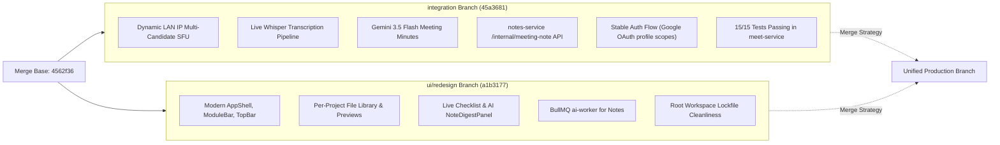

# 🔀 Branch Merge Strategy: `ui/redesign` into `integration`

## 1. Executive Summary

- **Target Branch**: `integration` (tip commit: `45a3681`)
- **Source Branch**: `ui/redesign` (tip commit: `a1b3177`)
- **Common Merge Base**: `4562f36` (Added Icons and images)
- **Scope of Changes**: 435 files modified/added across frontend redesign, file libraries, notes rework, and background workers.

### Primary Objectives:
1. **Absorb Redesign Upgrades**: Incorporate the modern navigation shell (`AppShell`, `ModuleBar`, persistent sidebar), project file hub (`FileLibrary`), real user settings, and AI notes worker.
2. **Preserve Integration Features**: Ensure zero regression to the working auth flow, dynamic LAN IP Mediasoup SFU (`network.ts`), and the live Whisper meeting-to-notes transcription pipeline.
3. **Prevent Known Regressions**: Fix the `@repo/shared` module resolution bug that broke `auth-service` on `ui/redesign`.

---

## 2. Feature & Divergence Comparison Matrix



| Domain | `integration` (Our Current State) | `ui/redesign` (Branch to Merge) | Merge Resolution Strategy |
|---|---|---|---|
| **Meet SFU** | Auto-detecting LAN IP (`network.ts`), loopback + LAN `listenIps` | Static IP / Older SFU transport | **Take `integration` version**: Preserve dynamic IP auto-detection. |
| **Meeting Transcription** | Groq Whisper + Gemini AI minutes + room concurrency lock | None (mock meeting chat only) | **Take `integration` version**: Port `useMeetingAudioCapture` and controls into redesign layout. |
| **Auth Service** | Working BetterAuth, no broken shared imports | Broken `@repo/shared` workspace import | **Take `integration` version**: Keep local resilient imports or fix `tsconfig.json` path aliasing. |
| **Navigation & Layout** | Classic page layout | `AppShell.tsx`, `ModuleBar.tsx`, persistent navigation | **Take `ui/redesign` version**: Adopt new modern layout shell. |
| **Notes Service** | `/internal/meeting-note` endpoints for real-time transcription | Notes checklist rework & AI digest panel | **Combine Both**: Add `meeting-note.controller.ts` into redesign's notes structure. |
| **Files & Projects** | Basic project view | `FileLibrary.tsx`, `FilePreview.tsx`, project member dialogs | **Take `ui/redesign` version**: Full file management system. |
| **Lockfiles** | Per-service lockfiles present | Root monorepo lockfile, dropped stale locks | **Take `ui/redesign` version**: Clean root lockfile. |

---

## 3. High-Risk Conflict Hotspots & Solutions

### Hotspot 1: `@repo/shared` Import Resolution Failure in `auth-service`
- **Root Cause in `ui/redesign`**:
  `auth-service/src/services/publisher.service.ts` imported `@repo/shared`. When running `bun dev` (Node/Bun standalone), Node threw `ERR_MODULE_NOT_FOUND: Cannot find package '@repo/shared'` because `@repo/shared` was not built into `dist/` and `package.json` had `"@repo/shared": "workspace:^"` without symlink resolution.
- **Resolution**:
  In `code/services/auth-service/tsconfig.json`, ensure path aliases are configured:
  ```json
  "paths": {
    "@repo/shared": ["../../packages/shared/src/index.ts"]
  }
  ```
  And in `code/services/auth-service/src/services/publisher.service.ts`, retain the defensive event publishing fallback so `auth-service` never crashes if `@repo/shared` is absent.

### Hotspot 2: `code/apps/ui/src/pages/meet/MeetPage.tsx`
- **Conflict**:
  - `ui/redesign` simplified the meet page container to fit inside `AppShell`.
  - `integration` added the "Transcribe" button, recording timer, concurrency badge, and `useMeetingAudioCapture` hook.
- **Resolution**:
  Keep the outer container wrapper compatible with `AppShell`, while preserving the entire meeting control bar:
  - Bottom bar Transcribe button (`useMeetingAudioCapture`).
  - Active transcription banner (`Transcribing to Notes [View Note]`).
  - Web Audio microphone + remote stream mixer.

### Hotspot 3: `code/services/meet-service/`
- **Resolution**:
  Keep `code/services/meet-service` almost entirely from `integration`:
  - `src/sfu/network.ts` (Dynamic LAN IP)
  - `src/sfu/transport.ts` (Dual candidates)
  - `src/services/transcription.service.ts` (Groq/Whisper + Gemini)
  - `tests/unit/transcription.service.test.ts` & `tests/api_key.test.ts`.

### Hotspot 4: `code/services/notes-service/`
- **Resolution**:
  Preserve the endpoints added in `integration`:
  - `src/controllers/meeting-note.controller.ts`
  - `src/routes/document.routes.ts` (`/internal/meeting-note/init`, `/:id/append`, `/:id/finalize`)
  - `src/services/document.service.ts` (`appendTranscript` and `finalizeMeetingMinutes`).

---

## 4. Step-by-Step Merge Execution Plan

### Step 1: Pre-Merge Safety Backup
Create a snapshot tag and backup branch before initiating merge operations:
```bash
git checkout integration
git tag backup/integration-pre-merge-$(date +%Y%m%d)
git checkout -b integration-merge-ui-redesign
```

### Step 2: Merge with `--no-commit`
Perform the merge without committing immediately so all conflicts can be inspected:
```bash
git merge ui/redesign --no-commit
```

### Step 3: Conflict Resolution Order
Resolve conflicts service-by-service in the following sequence:

1. **`code/packages/shared/`**:
   - Accept redesign's shared constants and types.
   - Run `bun run build` inside `code/packages/shared` to ensure artifacts exist.
2. **`code/services/auth-service/`**:
   - Check `publisher.service.ts` and `package.json`.
   - Ensure `auth-service` starts cleanly with `bun dev` without `@repo/shared` module errors.
3. **`code/services/meet-service/`**:
   - `git checkout HEAD -- code/services/meet-service` (Keep integration's tested version).
4. **`code/services/notes-service/`**:
   - Merge `document.routes.ts` and ensure `meeting-note.controller.ts` is staged.
5. **`code/apps/ui/`**:
   - Keep redesign's `AppShell.tsx`, `Sidebar.tsx`, `TopBar.tsx`, `ModuleBar.tsx`, `FileLibrary.tsx`.
   - In `MeetPage.tsx`, verify `useMeetingAudioCapture` and transcription state are connected.

### Step 4: Monorepo Compilation Gate
Verify that every workspace package compiles:
```bash
# 1. Shared packages
cd code/packages/shared && bun run build

# 2. Services
cd ../../services/auth-service && bun run build
cd ../meet-service && bun run build
cd ../notes-service && bun run build
cd ../project-service && bun run build
cd ../chat-service && bun run build

# 3. Frontend Apps
cd ../../apps/ui && bun run build
cd ../web && bun run build
```

### Step 5: Test Suite Execution
Run test suites across all modified services:
```bash
# meet-service (SFU, Transcription, API Keys)
cd code/services/meet-service && bun vitest run

# auth-service (Authentication, Reset Password)
cd ../auth-service && bun vitest run

# notes-service
cd ../notes-service && bun vitest run
```

### Step 6: Commit and Fast-Forward Merge
Once all builds and tests pass:
```bash
git commit -m "merge(ui/redesign): integrate modern AppShell, file library, and notes overhaul while preserving dynamic SFU & live transcription"
git checkout integration
git merge integration-merge-ui-redesign --ff-only
```

---

## 5. Rollback Strategy

If any unforeseen blocker arises during verification:
```bash
# Abort merge in progress
git merge --abort

# Or restore to the pre-merge backup tag
git checkout integration
git reset --hard backup/integration-pre-merge-<date>
```
