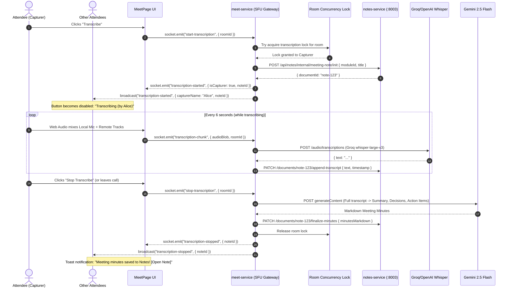

# Implementation Plan: Live Meeting Transcription to Notes via Whisper & Gemini

## Goal Description
Implement an on-demand live meeting transcription and meeting minutes generation pipeline for Vero:
1. **Single-Attendee On-Demand Trigger**: In any ongoing meeting within a module, any attendee can click a **"Transcribe"** button. The attendee who clicks becomes the active audio capturer.
2. **Server Concurrency Lock**: Distributed/atomic room-level concurrency control ensures only one attendee can run transcription at a time; all other attendees immediately see a disabled button indicating `"Transcribing (by [Attendee Name])"`.
3. **High-Speed Audio Transcription via Whisper**: The capturer's browser mixes local microphone + all incoming remote participant audio tracks into 6-second slices. These are transcribed via **Groq Whisper** (`whisper-large-v3`, <200ms latency on free tier) or **OpenAI Whisper** (`whisper-1`).
4. **Direct Delivery to `notes-service`**: Transcripts are streamed directly into an active module document in `notes-service`.
5. **AI Meeting Minutes Generation**: When transcription is stopped (or the meeting ends), a separate AI call (**Gemini 2.5 Flash**) processes the full transcript to generate structured **Executive Summary**, **Key Decisions**, and **Action Items** (as interactive checklists), prepending them to the document right above the full transcript.

---

## User Review Required

> [!IMPORTANT]
> **API Key Setup**:
> - **Whisper Transcription**: We will support **`GROQ_API_KEY`** (primary, fastest with generous free tier) with automatic fallback to **`OPENAI_API_KEY`**.
> - **Meeting Minutes AI**: We will use **`GEMINI_API_KEY`** calling Google's `gemini-2.5-flash` model for high-quality structured meeting minutes.
> - Both can be configured in [`code/services/meet-service/.env`](file:///media/nafis/Softwares/SPL2/Vero_SPL2/code/services/meet-service/.env).

> [!NOTE]
> **Audio Mixing & Resilience**:
> - The capturer's browser captures the entire conversation by combining their local mic stream + all remote participant audio tracks through the browser's Web Audio `AudioContext.createMediaStreamDestination()`.
> - If the active capturer disconnects or leaves the call, the server detects socket disconnection, marks the current transcript chunk complete, triggers AI minutes finalization, and releases the room lock so another participant can resume if needed.

---

## Architecture Flow



---

## Proposed Changes

---

### Component 1: `meet-service` Backend

#### [MODIFY] [`code/services/meet-service/src/config/env.ts`](file:///media/nafis/Softwares/SPL2/Vero_SPL2/code/services/meet-service/src/config/env.ts)
- Add environment variables:
  - `NOTES_SERVICE_URL: z.string().default('http://localhost:8003')`
  - `GROQ_API_KEY: z.string().optional()`
  - `OPENAI_API_KEY: z.string().optional()`
  - `GEMINI_API_KEY: z.string().optional()`

#### [MODIFY] [`code/services/meet-service/.env.example`](file:///media/nafis/Softwares/SPL2/Vero_SPL2/code/services/meet-service/.env.example) & [`.env`](file:///media/nafis/Softwares/SPL2/Vero_SPL2/code/services/meet-service/.env)
- Include template variables for `GROQ_API_KEY`, `OPENAI_API_KEY`, and `GEMINI_API_KEY`.

#### [NEW] [`code/services/meet-service/src/services/transcription.service.ts`](file:///media/nafis/Softwares/SPL2/Vero_SPL2/code/services/meet-service/src/services/transcription.service.ts)
- `TranscriptionService` class managing in-memory active transcription state per room:
  ```ts
  interface RoomTranscription {
    roomId: string;
    moduleId: string;
    capturerSocketId: string;
    capturerUserId: string;
    capturerName: string;
    noteId: string;
    transcriptBuffer: Array<{ timestamp: string; speakerName: string; text: string }>;
    startedAt: Date;
  }
  ```
- Methods:
  - `startTranscription(roomId, moduleId, user, socketId)`:
    - Atomic concurrency check: returns error if already active.
    - Calls `notes-service` to initialize note: `Meeting Minutes — [Formatted Date]`.
  - `processAudioChunk(roomId, socketId, audioBuffer)`:
    - Verifies `socketId === roomTranscription.capturerSocketId`.
    - Dispatches audio to Groq Whisper (`https://api.groq.com/openai/v1/audio/transcriptions`) or OpenAI Whisper.
    - Appends transcribed line to `notes-service`.
  - `stopTranscription(roomId, user)`:
    - Compiles full transcript.
    - Calls Gemini (`gemini-2.5-flash`) with structured prompt for **Executive Summary**, **Key Decisions**, and **Action Items**.
    - Prepend-updates note in `notes-service`.
    - Cleans up room lock.

#### [MODIFY] [`code/services/meet-service/src/ws/message-router.ts`](file:///media/nafis/Softwares/SPL2/Vero_SPL2/code/services/meet-service/src/ws/message-router.ts)
- Handle `start-transcription`: Acquires lock and broadcasts `transcription-started`.
- Handle `transcription-audio-chunk`: Receives binary slice from capturer.
- Handle `stop-transcription`: Stops, triggers Gemini, broadcasts `transcription-stopped`.
- In `disconnect` handler: If disconnecting socket was the capturer, automatically finalize transcription.

---

### Component 2: `notes-service` Backend

#### [NEW] [`code/services/notes-service/src/controllers/internal-meeting.controller.ts`](file:///media/nafis/Softwares/SPL2/Vero_SPL2/code/services/notes-service/src/controllers/internal-meeting.controller.ts)
- `initMeetingNote(req, res)`:
  - Creates note with `visibility: 'public'`, `editPermission: 'editable'`, titled `Meeting Minutes — [Date]`.
  - Sets initial template with header and placeholder for Live Transcript.
- `appendTranscript(req, res)`:
  - Appends timestamped speech lines directly to `contentSnapshot` and saves state.
- `finalizeMinutes(req, res)`:
  - Formats the final document:
    - `# 📋 Meeting Minutes — [Date]`
    - `## 📌 Executive Summary`
    - `## 🎯 Key Decisions`
    - `## ✅ Action Items`
    - `---`
    - `## 🎙️ Full Meeting Transcript`

#### [MODIFY] [`code/services/notes-service/src/routes/document.routes.ts`](file:///media/nafis/Softwares/SPL2/Vero_SPL2/code/services/notes-service/src/routes/document.routes.ts)
- Expose the internal endpoints:
  - `POST /api/notes/internal/meeting-note/init`
  - `PATCH /api/notes/internal/meeting-note/:id/append`
  - `PATCH /api/notes/internal/meeting-note/:id/finalize`

---

### Component 3: `apps/ui` Frontend

#### [NEW] [`code/apps/ui/src/features/meet-module/hooks/useMeetingAudioCapture.ts`](file:///media/nafis/Softwares/SPL2/Vero_SPL2/code/apps/ui/src/features/meet-module/hooks/useMeetingAudioCapture.ts)
- Custom hook managing the Web Audio capture pipeline:
  - Creates `AudioContext` and `createMediaStreamDestination()`.
  - Connects local microphone track (if unmuted).
  - Connects all active remote participant audio tracks from `useMeetStore.getState().participants`.
  - Initializes `MediaRecorder(destinationStream, { mimeType: 'audio/webm;codecs=opus' })`.
  - Slices audio into 6000ms buffers and emits via `socket.emit('transcription-audio-chunk', buffer)`.

#### [MODIFY] [`code/apps/ui/src/stores/meet.store.ts`](file:///media/nafis/Softwares/SPL2/Vero_SPL2/code/apps/ui/src/stores/meet.store.ts)
- Add state for transcription:
  - `isTranscribing: boolean`
  - `isCapturer: boolean`
  - `transcribingUser: string | null`
  - `meetingNoteId: string | null`
  - Actions: `startTranscription()`, `stopTranscription()`
- Listen for socket events:
  - `transcription-started`: updates store, disables button for non-capturers, starts audio capture for capturer.
  - `transcription-stopped`: cleans up recorder, shows toast with note link.
  - `transcription-error`: shows toast warning if concurrency conflict occurred.

#### [MODIFY] [`code/apps/ui/src/pages/meet/MeetPage.tsx`](file:///media/nafis/Softwares/SPL2/Vero_SPL2/code/apps/ui/src/pages/meet/MeetPage.tsx)
- In the bottom control bar:
  - Add `TranscribeButton`:
    - **Idle**: `<ControlButton icon={<FileAudio />} label="Transcribe" onClick={startTranscription} />`
    - **Capturing (Active)**: `<ControlButton icon={<StopCircle className="text-red-400 animate-pulse" />} label="Stop Transcribe" onClick={stopTranscription} danger />`
    - **Another User Capturing**: `<ControlButton icon={<FileAudio className="text-amber-400" />} label="Transcribing (by Bob)" disabled />`
- Floating status badge when transcribing: `● Transcribing live to Notes — [Open Note]`

---

## Verification Plan

### Automated Tests
1. **Concurrency Control Test**:
   - Write integration test simulating two sockets concurrently emitting `start-transcription` for the same room. Verify only one succeeds and the other receives `transcription-error`.
   ```bash
   cd code/services/meet-service && bun test tests/integration/transcription-concurrency.test.ts
   ```
2. **Notes Generation Test**:
   - Verify `initMeetingNote`, `appendTranscript`, and `finalizeMinutes` endpoints in `notes-service`.
   ```bash
   cd code/services/notes-service && bun test tests/integration/meeting-note.test.ts
   ```
3. **Build Integrity**:
   ```bash
   cd code/apps/web && bun run build
   cd code/services/meet-service && bun run build
   cd code/services/notes-service && bun run build
   ```

### Manual Verification
1. **Single Attendee Flow**:
   - Join meeting in `/project/:p/module/:m/meet`.
   - Click **Transcribe**. Verify that the button switches to **Stop Transcribe** (pulsing).
   - Speak for ~15 seconds.
   - Click **Stop Transcribe**.
   - Open `/project/:p/module/:m/notes`.
   - Verify that the note contains the generated **Executive Summary**, **Key Decisions**, **Action Items**, and **Full Transcript**.
2. **Multi-User Concurrency Verification**:
   - Open the same meeting in two browser windows (User A & User B).
   - User A clicks **Transcribe**.
   - Verify User B's button immediately updates to **"Transcribing (by User A)"** and becomes disabled.
   - Verify User B cannot start another transcription process.
