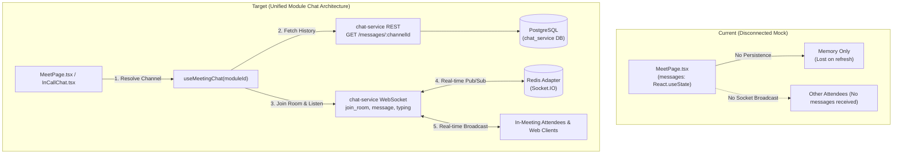
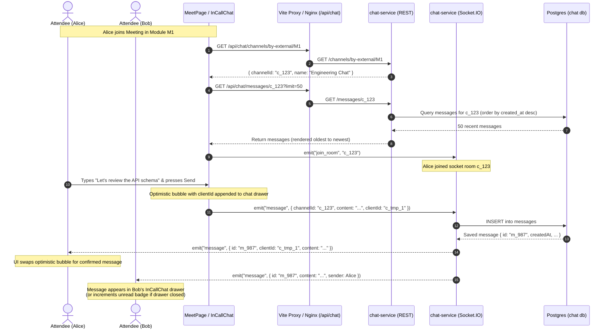

# 📋 Architectural Plan: Module Chat Integration for Meetings

## 1. Executive Summary & Objective

In Vero, every project module (e.g. `Engineering`, `Product Design`, `Sprint 42`) has a collaborative context containing a Kanban Board, Collaborative Notes, Live Meeting SFU, and a dedicated Module Chat.

Currently, the in-meeting chat drawer in [`code/apps/ui/src/pages/meet/MeetPage.tsx`](file:///media/nafis/Softwares/SPL2/Vero_SPL2/code/apps/ui/src/pages/meet/MeetPage.tsx) relies on a volatile React local state (`const [messages, setMessages] = useState([])`). When attendees send messages inside the meeting:
- Messages are **not** broadcast over WebSockets to other meeting participants.
- Messages are **not** persisted to the database.
- Chat history for the module is **not** loaded.
- Refreshing or closing the drawer discards all conversation history.

### The Objective
Connect the in-meeting chat drawer directly to `chat-service` (port 8005) so that:
1. **Unified Module Stream**: Messages sent during a meeting belong to the parent module's chat channel. Team members chatting from the module Chat tab and attendees in the live meeting share the exact same real-time message stream.
2. **History Hydration**: Opening the meeting or chat panel loads recent message history (`GET /messages/:channelId?limit=50`).
3. **Live Bidirectional Sync**: Uses the existing Socket.IO connection to `chat-service` (`join_room`, `message`, `typing`) with optimistic UI bubbles.
4. **Unread Indicator**: A badge on the meeting control bar alerts participants when new messages arrive while the chat drawer is collapsed.

---

## 2. Current Architecture vs. Target Architecture



---

## 3. Module Channel Resolution Strategy

When a module is provisioned by `project-service` ([`orchestrator.worker.ts`](file:///media/nafis/Softwares/SPL2/Vero_SPL2/code/services/project-service/src/worker/orchestrator.worker.ts)), a corresponding chat channel is already created in `chat-service` with:
- `externalId = moduleId`
- `type = 'group'`
- `workspaceId = workspaceId`
- `name = "${moduleName} Chat"`
- `chatResourceId` is stored in `modules` table in `project-service`.

### Resolution Paths for `MeetPage`

1. **Option A (Preferred — Direct Channel by External ID)**:
   Add an endpoint or query parameter in `chat-service`:
   `GET /channels/by-external/:externalId` (e.g. `GET /api/chat/channels/by-external/:moduleId`).
   - If found: returns the channel object (`{ id, name, type, ... }`).
   - If not found (e.g., legacy module created prior to worker provisioning): lazily creates the channel and adds the current workspace/module members.

2. **Option B (Via Module Metadata in `project.store.ts`)**:
   `project.store.ts` already fetches the active module, which includes `chatResourceId`. If populated, `chatResourceId` is the `channelId`.

**Recommendation**: Use **Option A** (`GET /channels/by-external/:moduleId`) as the primary mechanism with fallback to lazy creation. This guarantees any module (new or existing) immediately resolves to a valid `channelId`.

---

## 4. Message Flow & Sequence Diagram



---

## 5. Detailed Step-by-Step Implementation Plan

### Phase 1: Backend (`chat-service`) Enhancements

1. **Add `getOrCreateByExternalId` to `channel.service.ts`**:
   - Query: `db.query.channels.findFirst({ where: eq(channels.externalId, externalId) })`.
   - If not found, create a group channel with `name: "${moduleName || 'Module'} Chat"`, `type: 'group'`, `externalId: moduleId`.
   - Automatically ensure the requesting `userId` is added to `channel_members`.
2. **Expose Route in `channel.routes.ts`**:
   - `GET /channels/external/:externalId` -> `channelController.getChannelByExternalId`.
3. **Verify CORS & Proxy Settings**:
   - Ensure `code/apps/web/vite.config.ts` proxies `/api/chat` -> `http://localhost:8005` correctly (already verified).

---

### Phase 2: Frontend Client & Hook Architecture

1. **Populate [`InCallChat.tsx`](file:///media/nafis/Softwares/SPL2/Vero_SPL2/code/apps/ui/src/components/meet/InCallChat.tsx)**:
   Extract the in-meeting chat UI into a clean, reusable component rather than inlining it in `MeetPage.tsx`:
   - Props: `{ channelId: string; isOpen: boolean; onClose: () => void }`.
   - Message bubble list with scroll-to-bottom anchor.
   - Distinct styling for current user vs. remote attendees (matching Vero's dark theme: `#09090b` / `bg-indigo-600` for self).
   - Timestamp display (`toLocaleTimeString([], { hour: '2-digit', minute: '2-digit' })`).
   - Compact composer input with Enter-to-send and Send button.

2. **Create Custom Hook `useMeetingChat.ts`**:
   File: `code/apps/ui/src/features/meet-module/hooks/useMeetingChat.ts`
   - **State**:
     - `messages: ChatMessage[]`
     - `isLoading: boolean`
     - `channelId: string | null`
     - `unreadCount: number` (resets to 0 when panel is active)
   - **Lifecycle**:
     - On mount with `moduleId`: calls `GET /api/chat/channels/external/:moduleId` to resolve `channelId`.
     - Fetches history via `GET /api/chat/messages/:channelId?limit=50`.
     - Connects or attaches to the `chat-service` Socket.IO instance:
       - Emits `join_room(channelId)`.
       - Registers `socket.on('message')`:
         - If `msg.channelId === channelId`: appends message (or reconciles optimistic `clientId`).
         - If `activePanel !== 'chat'`: increments `unreadCount`.
       - On unmount or channel change: emits `leave_room(channelId)`.
   - **Actions**:
     - `sendMessage(content: string)`: creates optimistic bubble, emits `socket.emit('message', { channelId, content, clientId })`.

---

### Phase 3: Integration into `MeetPage.tsx`

1. **Replace Local State in `MeetPage.tsx`**:
   - Remove `const [messages, setMessages] = useState<any[]>([])`.
   - Instantiate `const { messages, sendMessage, unreadCount, isChatLoading } = useMeetingChat(moduleId, activePanel === 'chat')`.
2. **Update Control Bar Chat Button**:
   - Add unread notification pill when `unreadCount > 0` and chat panel is closed:
     ```tsx
     <button onClick={() => togglePanel('chat')} className="relative ...">
       <MessageSquare className="w-5 h-5" />
       {unreadCount > 0 && !showPanel && (
         <span className="absolute -top-1 -right-1 bg-indigo-500 text-white text-[10px] font-bold rounded-full w-4 h-4 flex items-center justify-center">
           {unreadCount > 9 ? '9+' : unreadCount}
         </span>
       )}
     </button>
     ```
3. **Render `InCallChat` Inside Side Drawer and Overlay**:
   - Replace lines 1292–1336 and 1530–1568 in `MeetPage.tsx` with `<InCallChat ... />`.

---

## 6. Edge Cases & Error Handling

| Edge Case | Mitigation |
|---|---|
| **Module created before chat service integration** | `getChannelByExternalId` creates channel on the fly if no record exists for `moduleId`. |
| **User drops and reconnects Wi-Fi** | Socket.IO automatic reconnection re-emits `join_room(channelId)` on the `connect` event. |
| **Sender clicks send while socket is briefly disconnected** | Message marked with `pending: true` and queued or retried via REST POST `/messages`. |
| **Multiple tabs / same user in meeting** | `clientId` reconciliation ensures the user's echo does not duplicate their own bubble. |
| **Messages sent outside the meeting** | Automatically received in real-time by attendees if they are in the module's room. |

---

## 7. Testing & Verification Checklist

- [ ] **Backend Unit/Integration Tests**:
  - `code/services/chat-service/tests/channel.external.test.ts`: test `getOrCreateByExternalId` resolution and member assignment.
- [ ] **Socket Verification**:
  - Verify `join_room` and `message` broadcast work between two separate authenticated client sessions.
- [ ] **UI Verification in Meeting**:
  - Attendee A sends a message in meeting -> Attendee B sees it instantly.
  - Close chat drawer on Attendee B -> Attendee A sends message -> Attendee B sees unread count badge increment.
  - Refresh browser -> previous messages reload from `chat-service` history.
  - Navigate to module Chat tab (`/project/:p/module/:m/chat`) -> verify meeting messages are visible there.
