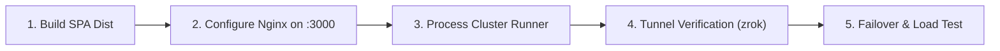

# 🌐 Nginx Reverse Proxy, Static SPA Hosting & Intelligent Load Balancing Plan

## 1. Executive Summary & Clarification of Core Architectural Queries

This plan establishes a unified, low-overhead edge architecture for Vero that eliminates Vite proxying in favor of **Nginx as a static file server and API gateway**, introduces **single-port ingress tunneling via `zrok` / `ngrok`**, and addresses **bare-metal process clustering vs. Dockerization**.

### Clarification of Key Questions:

| Question | Architectural Verdict | Recommendation & Explanation |
| :--- | :--- | :--- |
| **1. Static SPA Hosting vs. Vite Dev Proxy** | **Nginx hosts `dist/` directly on port 3000 (or 8080/80)** | In development, Vite proxied `/api/*` requests to services. In production and staging, **Vite is removed from the runtime path**. Nginx directly serves the pre-built `code/apps/web/dist` static assets and reverse proxies all `/api/*` and WebSocket traffic (`/api/auth/*`, `/api/chat/*`, `/api/meet/*`, etc.). |
| **2. Tunneling (`zrok` vs. `ngrok`)** | **Single Tunnel to Nginx Port 3000** | Because Nginx unifies static assets and all backend microservices behind one single port (e.g. `localhost:3000`), **you only ever need ONE tunnel**. The client accesses the single tunnel URL (`https://xyz.share.zrok.io`), loads the HTML/JS, and makes relative API calls (`/api/...`) that route right back through the same tunnel into Nginx. **Recommendation**: Stay with `zrok` (no 2-hour free tier timeout, no ngrok interstitial warning page, full WebSocket support); keep `ngrok` as a plug-and-play fallback. |
| **3. Docker vs. Bare-Metal Multi-Instance** | **Do NOT dockerize everything for local dev; use process port offsets** | You are 100% correct regarding resource usage. Running microservices natively via `bun` / `tsx` uses ~50–80 MB RAM per instance without container overhead. Docker containers add overlay filesystem, container engine, and virtualization overhead (~300–500 MB per container). We run multiple local instances simply by launching processes with port offsets (`PORT=8001` and `PORT=8011`). Nginx treats them identically as upstream TCP sockets. |
| **4. Where Docker Fits In** | **`docker-compose.yml` is for Staging & Cloud Deployments** | Docker Compose provides an immutable, one-click deployment artifact on remote VPS/cloud servers where you don't want to install Node/Bun/Postgres directly on the host. |
| **5. Tunneling with Docker** | **Host-level Tunnel (Simplest) OR Containerized Tunnel (Token)** | **Method A (Recommended)**: Docker publishes Nginx to host port 3000 (`ports: ["3000:80"]`). You run `zrok share public http://localhost:3000` on the host machine. Zero config needed inside Docker. <br/>**Method B (Self-contained)**: Run official `openziti/zrok` or `ngrok/ngrok` service in `docker-compose.yml` injecting `ZROK_ENABLE_TOKEN` or `NGROK_AUTHTOKEN`. |

---

## 2. Architecture & Data Flow Diagram

```mermaid
flowchart TD
    PublicUsers["Remote Attendees & Clients<br/>(Browsers, Mobile, Desktop)"]

    subgraph IngressTunnel["Public Ingress Layer (Single Port)"]
        Tunnel["zrok share public http://localhost:3000<br/>OR ngrok http 3000<br/>(Exposes Single HTTPS URL)"]
    end

    subgraph HostGateway["Host Edge Gateway: Nginx (Port 3000 / 8080)"]
        Nginx["Nginx Gateway"]
        StaticDist["Built Static SPA<br/>(code/apps/web/dist)"]
    end

    subgraph ServiceUpstreams["Microservice Clusters (Bare-metal Port Offsetting OR Docker)"]
        subgraph AuthCluster["Auth Cluster (least_conn)"]
            Auth1["auth-1: 127.0.0.1:8001"]
            Auth2["auth-2: 127.0.0.1:8011"]
        end

        subgraph ProjectCluster["Project Cluster (least_conn)"]
            Proj1["project-1: 127.0.0.1:8004"]
            Proj2["project-2: 127.0.0.1:8014"]
        end

        subgraph ChatCluster["Chat Cluster (ip_hash)"]
            Chat1["chat-1: 127.0.0.1:8005"]
            Chat2["chat-2: 127.0.0.1:8015"]
        end

        subgraph NotesCluster["Notes Cluster (room-hash)"]
            Notes1["notes-1: 127.0.0.1:8003"]
            Notes2["notes-2: 127.0.0.1:8013"]
        end

        subgraph MeetCluster["Meet SFU Signaling Cluster (room-hash)"]
            Meet1["meet-1: 127.0.0.1:8007"]
            Meet2["meet-2: 127.0.0.1:8017"]
        end
    end

    subgraph SharedTier["Shared State Tier"]
        Redis[("Redis (Pub/Sub, Adapters)")]
        Postgres[("PostgreSQL DB")]
    end

    PublicUsers -->|HTTPS / WSS| Tunnel
    Tunnel -->|Forward to localhost:3000| Nginx

    Nginx -->|GET / & /assets/*| StaticDist
    Nginx -->|/api/auth/*| AuthCluster
    Nginx -->|/api/project/*| ProjectCluster
    Nginx -->|/api/chat/* (WSS)| ChatCluster
    Nginx -->|/api/notes/* (WSS)| NotesCluster
    Nginx -->|/api/meet/* (WSS)| MeetCluster

    AuthCluster <--> Redis & Postgres
    ProjectCluster <--> Redis & Postgres
    ChatCluster <--> Redis & Postgres
    NotesCluster <--> Redis & Postgres
    MeetCluster <--> Redis & Postgres
```

---

## 3. Detailed Answers to Operational Queries

### 3.1. Single Ingress Tunneling (`zrok` vs `ngrok`)

#### How it works without multiple tunnels:
Because the web app uses relative URLs (`/api/auth/session`, `/api/chat`, etc.) and Nginx acts as both the file server and the reverse proxy:
1. Public user visits: `https://vero-team.share.zrok.io/`
2. `zrok` tunnels traffic to `http://localhost:3000`.
3. Nginx sees `GET /` -> serves `code/apps/web/dist/index.html`.
4. Client's browser executes JS, which calls `fetch('/api/auth/session')` and opens WebSocket `wss://vero-team.share.zrok.io/api/chat/socket.io`.
5. Because the origin is identical (`vero-team.share.zrok.io`), **CORS is completely eliminated**, and the request flows right back through the same tunnel into Nginx.
6. Nginx proxies the call to `vero_auth_cluster` (`127.0.0.1:8001` or `127.0.0.1:8011`).

#### Comparison: `zrok` vs `ngrok`

| Feature | `zrok` (Current) | `ngrok` | Recommendation |
| :--- | :--- | :--- | :--- |
| **Pricing & Limits** | 100% Free & Open Source | Free tier has strict bandwidth/connection caps | **Use `zrok` as primary** |
| **Session Lifetime** | Persistent tunnels | 2-hour session limit on unauthenticated free tier | `zrok` won't disconnect team meetings |
| **Interstitial Warning** | None (direct connection) | Displays "ngrok warning" landing page on free tier | `zrok` offers native app experience |
| **WebSocket Support** | Built-in (full RFC 6455 support) | Built-in | Both work identically for chat/notes |
| **WebRTC Media (UDP)** | HTTP tunnel proxies TCP signaling only | HTTP tunnel proxies TCP signaling only | Mediasoup audio/video streams via direct UDP ports or TURN |

---

### 3.2. Bare-Metal Multi-Instance vs. Dockerization

#### Why Native Bare-Metal Clustering is Better for Local Dev & Testing:
- **Resource Footprint**:
  - 10 Docker containers (2x Auth, 2x Project, 2x Chat, 2x Notes, 2x Meet) + Redis + Postgres + Nginx = **~4.5 GB to 7 GB RAM**, with constant container daemon CPU polling.
  - Native Bun/Node processes on Linux sharing the same OS page cache = **~800 MB to 1.4 GB total RAM**.
- **Execution Speed**: `bun` starts a service in ~40ms; Docker build and container start takes 5–30 seconds.
- **Port Offset Strategy**:
  - Instance 1 of each service runs on the base port (`8001` to `8007`).
  - Instance 2 runs with a `+10` offset:
    - `auth-service-2`: `PORT=8011`
    - `board-service-2`: `PORT=8012`
    - `notes-service-2`: `PORT=8013`
    - `project-service-2`: `PORT=8014`
    - `chat-service-2`: `PORT=8015`
    - `notification-service-2`: `PORT=8016`
    - `meet-service-2`: `PORT=8017`

---

### 3.3. How Tunneling Works When You *Do* Use Docker

You have two clean options when using `docker-compose.yml`:

#### Method A: Host-Level Tunnel (Zero Docker Configuration Needed)
1. In `docker-compose.yml`, Nginx exposes port 3000 to the host:
   ```yaml
   services:
     web:
       image: nginx:alpine
       ports:
         - "3000:80"
   ```
2. On your Linux host, simply run:
   ```bash
   zrok share public http://localhost:3000
   # OR
   ngrok http 3000
   ```
   *Result*: The tunnel speaks to `localhost:3000` on the host, which Docker forwards into the Nginx container. No zrok tokens or configs are needed inside Docker!

#### Method B: Containerized Tunnel Service (Self-Contained)
If you want the tunnel itself to run inside Docker (e.g. on a headless remote server):
```yaml
  zrok-tunnel:
    image: openziti/zrok
    restart: unless-stopped
    environment:
      - ZROK_ENABLE_TOKEN=${ZROK_TOKEN}
    command: ["share", "public", "http://web:80", "--headless"]
    depends_on:
      - web
```

---

## 4. Nginx Configuration Blueprint (`nginx.conf`)

Below is the complete configuration hosting the built `dist/` frontend at port `3000` while load-balancing all microservices across local instances:

```nginx
worker_processes auto;
events {
    worker_connections 4096;
    multi_accept on;
    use epoll;
}

http {
    include mime.types;
    default_type application/octet-stream;

    # Performance
    sendfile on;
    tcp_nopush on;
    tcp_nodelay on;
    keepalive_timeout 65;
    types_hash_max_size 2048;
    client_max_body_size 60m;

    # WebSocket Upgrade Mapping
    map $http_upgrade $connection_upgrade {
        default upgrade;
        ''      close;
    }

    # ==========================================
    # UPSTREAM CLUSTERS (Bare-Metal or Docker)
    # ==========================================

    # Stateless REST (Least Connections + Failover)
    upstream vero_auth_cluster {
        least_conn;
        server 127.0.0.1:8001 max_fails=3 fail_timeout=10s;
        server 127.0.0.1:8011 max_fails=3 fail_timeout=10s;
        keepalive 32;
    }

    upstream vero_project_cluster {
        least_conn;
        server 127.0.0.1:8004 max_fails=3 fail_timeout=10s;
        server 127.0.0.1:8014 max_fails=3 fail_timeout=10s;
        keepalive 32;
    }

    upstream vero_board_cluster {
        least_conn;
        server 127.0.0.1:8002 max_fails=3 fail_timeout=10s;
        server 127.0.0.1:8012 max_fails=3 fail_timeout=10s;
        keepalive 32;
    }

    # Stateful WebSockets (IP Hash for Handshake Stability)
    upstream vero_chat_cluster {
        ip_hash;
        server 127.0.0.1:8005 max_fails=3 fail_timeout=10s;
        server 127.0.0.1:8015 max_fails=3 fail_timeout=10s;
        keepalive 64;
    }

    upstream vero_notification_cluster {
        ip_hash;
        server 127.0.0.1:8006 max_fails=3 fail_timeout=10s;
        server 127.0.0.1:8016 max_fails=3 fail_timeout=10s;
        keepalive 64;
    }

    # Collaborative Document & SFU Rooms (Consistent Room Hash)
    upstream vero_notes_cluster {
        hash $arg_room consistent;
        server 127.0.0.1:8003 max_fails=3 fail_timeout=10s;
        server 127.0.0.1:8013 max_fails=3 fail_timeout=10s;
        keepalive 64;
    }

    upstream vero_meet_cluster {
        hash $arg_roomId consistent;
        server 127.0.0.1:8007 max_fails=3 fail_timeout=10s;
        server 127.0.0.1:8017 max_fails=3 fail_timeout=10s;
        keepalive 64;
    }

    # ==========================================
    # GATEWAY SERVER (Port 3000)
    # ==========================================
    server {
        listen 3000;
        server_name localhost _;

        # Root directory of the pre-built Vite SPA
        root /media/nafis/Softwares/SPL2/Vero_SPL2/code/apps/web/dist;

        # Proxy Defaults
        proxy_http_version 1.1;
        proxy_set_header Host $host;
        proxy_set_header X-Real-IP $remote_addr;
        proxy_set_header X-Forwarded-For $proxy_add_x_forwarded_for;
        proxy_set_header X-Forwarded-Proto $scheme;
        proxy_set_header Upgrade $http_upgrade;
        proxy_set_header Connection $connection_upgrade;
        proxy_next_upstream error timeout invalid_header http_500 http_502 http_503;

        # ─── 1. Static Assets & SPA Routing ───
        location /assets/ {
            try_files $uri =404;
            add_header Cache-Control "public, max-age=31536000, immutable";
        }

        location = /sw.js {
            add_header Cache-Control "no-cache";
            try_files $uri =404;
        }

        # ─── 2. Microservice API Routes ───
        location /api/better-auth/ { proxy_pass http://vero_auth_cluster; }
        location /api/auth/        { proxy_pass http://vero_auth_cluster/auth/; }
        location /api/user/        { proxy_pass http://vero_auth_cluster/user/; }
        location /api/users/       { proxy_pass http://vero_auth_cluster/users/; }
        location /api/mail/        { proxy_pass http://vero_auth_cluster/mail/; }
        location /api/internal/    { proxy_pass http://vero_auth_cluster/internal/; }

        location /api/project/     { proxy_pass http://vero_project_cluster/project/; }
        location /api/board/       { proxy_pass http://vero_board_cluster; }
        
        location /api/chat/ {
            proxy_pass http://vero_chat_cluster/;
            proxy_read_timeout 3600s;
        }

        location /api/notes/ {
            proxy_pass http://vero_notes_cluster;
            proxy_read_timeout 3600s;
        }

        location /api/notifications {
            proxy_pass http://vero_notification_cluster/notifications;
            proxy_read_timeout 3600s;
        }

        location /api/meet/ {
            proxy_pass http://vero_meet_cluster/;
            proxy_read_timeout 3600s;
        }

        # ─── 3. Fallback to SPA Router ───
        location / {
            try_files $uri $uri/ /index.html;
            add_header Cache-Control "no-cache";
        }
    }
}
```

---

## 5. Step-by-Step Implementation Roadmap



### Phase 1: Build the Web App Dist
- Run `bun run build` in `code/apps/web` to populate `code/apps/web/dist`.
- Ensure all API calls in code use relative `/api/...` paths without hardcoded `localhost:800X` ports.

### Phase 2: Configure & Test Nginx on Port 3000
- Update `code/infra/nginx/nginx.conf` with the static file serving block and load-balanced upstream clusters.
- Test configuration: `nginx -t -c $(pwd)/code/infra/nginx/nginx.conf`.
- Start or reload Nginx. Verify `curl http://localhost:3000/` returns `index.html`.

### Phase 3: Cluster Runner Script (`scripts/cluster-dev.sh`)
- Create a lightweight runner script that starts primary and secondary instances:
  - Primary instances on ports 8001–8007.
  - Secondary instances on ports 8011–8017.
- Each instance runs via `bun` or `tsx` in the background with minimal memory usage.

### Phase 4: Public Ingress Tunneling Verification
- Run `zrok share public http://localhost:3000` (or `ngrok http 3000`).
- Open the public URL in an external browser / mobile device.
- Verify:
  1. Static assets load cleanly without MIME-type errors.
  2. BetterAuth login works through `/api/auth`.
  3. Real-time chat works via Socket.IO through the tunnel.
  4. Real-time notes work via Yjs WebSocket.

### Phase 5: Failover & Load Balancing Verification
- Use `autocannon` to hit `http://localhost:3000/api/auth/health` with 500 concurrent connections.
- Verify Nginx distributes requests between `127.0.0.1:8001` and `127.0.0.1:8011`.
- Kill instance 8001 while traffic is flowing: verify 100% of requests continue succeeding on instance 8011 without dropped connections (`proxy_next_upstream`).
