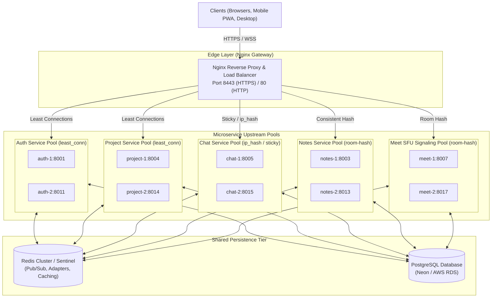

# 🌐 Nginx Reverse Proxy & Intelligent Load Balancing Architecture Plan

## 1. Executive Summary & Goals

As Vero scales from a local development environment into a high-concurrency production collaboration workspace, a single instance for each microservice becomes a bottleneck and single point of failure (SPOF).

This plan establishes an **intelligent Nginx reverse proxy architecture** capable of:
1. **Dynamic Load Distribution**: Routing requests to instances that are not currently under heavy load using the **`least_conn`** (Least Connections) and **`round-robin`** load-balancing algorithms.
2. **Protocol-Specific Routing**:
   - **Stateless REST Services** (`auth-service`, `project-service`, `board-service`): Weighted Least Connections (`least_conn`) with automatic failover.
   - **Stateful WebSockets** (`chat-service`, `notification-service`): Session-affinity (`ip_hash` / sticky) backed by Redis Socket.IO adapter.
   - **Document Collaboration** (`notes-service`): Room-aware hash routing (`hash $arg_room consistent`) for Yjs document synchronization.
   - **Video/Audio Conferencing** (`meet-service`): Room-affinity signaling combined with dedicated Mediasoup WebRTC UDP/TCP port distribution.
3. **Passive Health Checks & Resilience**: Instant failover when an instance crashes (`max_fails=3 fail_timeout=10s`) without dropping client sessions.
4. **Zero-Downtime Rolling Restarts**: Smooth instance cycling without interrupting active users.

---

## 2. Architecture & Topology Diagram



---

## 3. Load Balancing Algorithms Analysis

| Algorithm | Nginx Directive | Best Fit Service | Rationale |
|---|---|---|---|
| **Least Connections** | `least_conn;` | `auth-service`, `project-service`, `board-service` | Routes to the replica with the fewest active HTTP connections. Ideal when request execution times vary (e.g. file uploads or complex project queries vs. simple token validations). |
| **Weighted Round Robin** | *(default)* `server ... weight=N;` | Frontend Web / Static assets | Equal or weighted round-robin distribution for predictable, lightweight request loads. |
| **IP Hash / Sticky** | `ip_hash;` | `notification-service`, `chat-service` | Ensures Socket.IO clients hit the exact same server during the initial HTTP polling-to-WebSocket upgrade handshake. |
| **Consistent URL/Room Hash** | `hash $arg_roomId consistent;` | `notes-service` (Yjs), `meet-service` (Mediasoup) | Guarantees that participants collaborating in the same note or room land on the same in-memory room router, minimizing inter-node mesh hops. |

---

## 4. Nginx Configuration Blueprint (`nginx.conf`)

Below is the optimized configuration for multi-instance load balancing with health checks and connection pooling:

```nginx
events {
    worker_connections 4096;
    multi_accept on;
    use epoll;
}

http {
    include mime.types;
    default_type application/octet-stream;

    # Performance Tuning
    sendfile on;
    tcp_nopush on;
    tcp_nodelay on;
    keepalive_timeout 65;
    types_hash_max_size 2048;

    # Dynamic CORS origin mapping
    map $http_origin $cors_origin {
        default "";
        "~^http://localhost:(3000|5173|8080)$" $http_origin;
        "~^https://.*\.nip\.io:8443$" $http_origin;
        "~^https://localhost:8443$" $http_origin;
    }

    # ==========================================
    # UPSTREAM CLUSTERS
    # ==========================================

    # 1. Stateless HTTP: Auth Service (Least Connections)
    upstream vero_auth_cluster {
        least_conn;
        server 127.0.0.1:8001 max_fails=3 fail_timeout=10s;
        server 127.0.0.1:8011 max_fails=3 fail_timeout=10s;
        keepalive 32;
    }

    # 2. Stateless HTTP: Project Service (Least Connections)
    upstream vero_project_cluster {
        least_conn;
        server 127.0.0.1:8004 max_fails=3 fail_timeout=10s;
        server 127.0.0.1:8014 max_fails=3 fail_timeout=10s;
        keepalive 32;
    }

    # 3. Stateless HTTP: Board Service (Least Connections)
    upstream vero_board_cluster {
        least_conn;
        server 127.0.0.1:8002 max_fails=3 fail_timeout=10s;
        server 127.0.0.1:8012 max_fails=3 fail_timeout=10s;
        keepalive 32;
    }

    # 4. Stateful WebSockets: Chat Service (IP Hash for Handshake Stability)
    upstream vero_chat_cluster {
        ip_hash;
        server 127.0.0.1:8005 max_fails=3 fail_timeout=10s;
        server 127.0.0.1:8015 max_fails=3 fail_timeout=10s;
        keepalive 64;
    }

    # 5. Stateful WebSockets: Notification Service (IP Hash)
    upstream vero_notification_cluster {
        ip_hash;
        server 127.0.0.1:8006 max_fails=3 fail_timeout=10s;
        server 127.0.0.1:8016 max_fails=3 fail_timeout=10s;
        keepalive 64;
    }

    # 6. Real-time Collaborative Notes: Room-based Consistent Hash
    upstream vero_notes_cluster {
        hash $arg_room consistent;
        server 127.0.0.1:8003 max_fails=3 fail_timeout=10s;
        server 127.0.0.1:8013 max_fails=3 fail_timeout=10s;
        keepalive 64;
    }

    # 7. WebRTC SFU Meet Signaling: Room-based Hash
    upstream vero_meet_cluster {
        hash $arg_roomId consistent;
        server 127.0.0.1:8007 max_fails=3 fail_timeout=10s;
        server 127.0.0.1:8017 max_fails=3 fail_timeout=10s;
        keepalive 64;
    }

    # ==========================================
    # GATEWAY SERVER (SSL / PROXY)
    # ==========================================
    server {
        listen 8443 ssl;
        server_name localhost *.nip.io;

        ssl_certificate certs/nginx-selfsigned.crt;
        ssl_certificate_key certs/nginx-selfsigned.key;
        ssl_protocols TLSv1.2 TLSv1.3;
        ssl_ciphers HIGH:!aNULL:!MD5;

        # Proxy Buffering & Timeout Defaults
        proxy_connect_timeout 5s;
        proxy_send_timeout 60s;
        proxy_read_timeout 60s;
        proxy_next_upstream error timeout invalid_header http_500 http_502 http_503;

        # --- Microservice Routes ---

        location /api/auth/ {
            proxy_pass http://vero_auth_cluster/auth/;
            proxy_http_version 1.1;
            proxy_set_header Connection "";
            proxy_set_header Host $host;
            proxy_set_header X-Real-IP $remote_addr;
            proxy_set_header X-Forwarded-For $proxy_add_x_forwarded_for;
        }

        location /api/project/ {
            proxy_pass http://vero_project_cluster/project/;
            proxy_http_version 1.1;
            proxy_set_header Connection "";
            proxy_set_header Host $host;
            proxy_set_header X-Real-IP $remote_addr;
            proxy_set_header X-Forwarded-For $proxy_add_x_forwarded_for;
        }

        location /api/board/ {
            proxy_pass http://vero_board_cluster/;
            proxy_http_version 1.1;
            proxy_set_header Connection "";
            proxy_set_header Host $host;
            proxy_set_header X-Real-IP $remote_addr;
        }

        location /api/chat/ {
            proxy_pass http://vero_chat_cluster/;
            proxy_http_version 1.1;
            proxy_set_header Upgrade $http_upgrade;
            proxy_set_header Connection "Upgrade";
            proxy_set_header Host $host;
            proxy_read_timeout 3600s;
        }

        location /api/notes/ {
            proxy_pass http://vero_notes_cluster/;
            proxy_http_version 1.1;
            proxy_set_header Upgrade $http_upgrade;
            proxy_set_header Connection "Upgrade";
            proxy_set_header Host $host;
            proxy_read_timeout 3600s;
        }

        location /api/meet/ {
            proxy_pass http://vero_meet_cluster/;
            proxy_http_version 1.1;
            proxy_set_header Upgrade $http_upgrade;
            proxy_set_header Connection "Upgrade";
            proxy_set_header Host $host;
            proxy_read_timeout 3600s;
        }

        location /api/notifications/ {
            proxy_pass http://vero_notification_cluster/notifications/;
            proxy_http_version 1.1;
            proxy_set_header Upgrade $http_upgrade;
            proxy_set_header Connection "Upgrade";
            proxy_set_header Host $host;
            proxy_read_timeout 3600s;
        }
    }
}
```

---

## 5. Docker Compose Horizontal Scaling Strategy

To run multiple instances of services in Docker, use Docker Compose scaling with internal DNS or explicit port mappings:

```yaml
version: '3.8'

services:
  nginx:
    image: nginx:alpine
    ports:
      - "8443:8443"
      - "80:80"
    volumes:
      - ./nginx.conf:/etc/nginx/nginx.conf:ro
      - ./certs:/etc/nginx/certs:ro
    depends_on:
      - auth-service-1
      - auth-service-2
      - project-service-1
      - project-service-2

  auth-service-1:
    build: { context: ../../, dockerfile: Dockerfile.service, args: { SERVICE_NAME: auth-service } }
    environment:
      - PORT=8001
      - REDIS_URL=redis://redis:6379

  auth-service-2:
    build: { context: ../../, dockerfile: Dockerfile.service, args: { SERVICE_NAME: auth-service } }
    environment:
      - PORT=8011
      - REDIS_URL=redis://redis:6379
```

---

## 6. Implementation Milestones & Verification

1. **Phase 1: Update Nginx Configuration**:
   - Apply `least_conn` and `keepalive` directives in `code/infra/nginx/nginx.conf`.
   - Run `nginx -t` to test syntax.
2. **Phase 2: Multi-Instance Dev Runner**:
   - Update `dev-stack.sh` to allow spawning a secondary instance of high-traffic services (`PORT=8011 bun dev` for `auth-service-2`).
3. **Phase 3: Load & Failover Testing**:
   - Use `autocannon` or `k6` to send 1,000 concurrent requests to `/api/auth/health`.
   - Verify Nginx distributes load equally across both instances.
   - Kill `auth-1` process while load is running: verify Nginx immediately routes 100% of traffic to `auth-2` with **0 dropped requests** (`proxy_next_upstream`).
